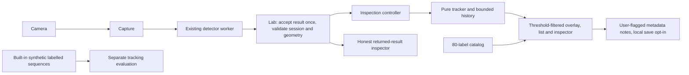

# Phase 2 tracking and decision inspector — proposed design

**Planning only; not implemented or approved for runtime work.** Codex proposes; Claude reviews;
the user approves before implementation. No merge, deployment, protection/automatic deployment
change or Phase 3 is authorized. Phase 1 closeout and accepted limitations remain in force.

## Inspected baseline and scope

Main: `19fd168bee3c22f8c2723d3be75f43ff8b922d50` (merge PR #8).
[Merge CI 40241503562](https://github.com/Harrisonxaph/Visual-Lab-AI/actions/runs/40241503562)
passed install/assets, typecheck, formatting, unit/browser, build and production checks. That
verifies the existing Phase 1 baseline, not any proposed Phase 2 feature.

| Existing boundary | Actual state / implication |
| --- | --- |
| `inference/types.ts` and worker | `Detection` has label, score and frame-pixel box. Worker selects `categories[0]`. No alternatives, logits, identities or rejected proposals reach the client. CPU/WASM module worker; configured floor 0.05 and cap 50. |
| `Lab.process` | One frame in flight; 100 ms minimum between starts. Generation checks discard stale capture/results. Snapshot contains frame dimensions and raw returned detections, but no committed-frame sequence, capture timing or tracking hook. |
| `main.ts` | Threshold filters/clips only while rendering. Slider and video resize can rerender the same snapshot: tracking must not update from `render`. |
| Overlay/CSS | Native-frame canvas inside an aspect-ratio container, `object-fit: contain`, no mirroring. Canvas currently ignores pointer events. Aspect changes suppress old overlays but do not notify a tracker. |
| Lifecycle/storage | Pause/hidden tab clears results and retains camera; Resume explicit; Stop/error/camera end releases resources. Optional threshold storage is guarded. No track store or failure log exists. |
| Labels/evaluation | `docs/COCO_LABELS.md` lists the pinned model's 80 named labels, with noncontiguous model IDs noted. No labelled tracking sequence or ground-truth identity metrics exist yet. |

Deliver Phase 2 IDs/association, trajectories, confidence histories/charts, lifecycle events,
selection/inspector, supported-category explorer, local failure notes and honest tracking-quality
measurement. Keep detection-only behavior usable. No appearance embedding/re-identification,
remote inference, footage capture, training/corrections, datasets, model comparison, zones/counting,
PWA, video replay or Phase 3 experiment/import/export system is included.

## Approaches and recommendation

1. Greedy IoU matching: smallest implementation, but assignment depends heavily on candidate order
   and handles competing overlaps poorly. Viable educational baseline; not chosen for this proposal.
2. **Proposed: gated minimum-cost one-to-one assignment**, with short constant-velocity center
   prediction, IoU/distance and a soft observed-class penalty. Bounded pure TypeScript; deterministic
   and independently testable. Better handles competing matches, still fails on ambiguous crossings.
3. SORT/appearance/re-identification stack: more tuning/dependencies and identity claims than this
   phase needs. Do not introduce it; alternative-algorithm comparisons remain a stretch target.

These are Codex's proposed choices, not decisions already approved by the user. Default constants
below are testable starting configuration, not measured optimums or a tracking-accuracy promise.

## Data and module boundaries

Keep camera/inference/scheduling ownership in existing modules. Add:

| Proposed file | Responsibility |
| --- | --- |
| `src/tracking/types.ts` | Frame, normalized geometry, config, track/sample/event/association and quality interfaces. |
| `src/tracking/geometry.ts` | Validate/clip pixel boxes, normalize, IoU, distance and contain-content pointer mapping. |
| `src/tracking/assignment.ts` | Deterministic rectangular Hungarian/minimum-cost assignment with explicit unmatched choices. No detector/UI imports. |
| `src/tracking/tracker.ts` | Association, tentative/active/lost/ended states and bounded samples/events. No camera/DOM/storage access. |
| `src/tracking/quality.ts` | Live descriptive counters/variability; no ground-truth identity claims. |
| `src/inspection/controller.ts` | Consume committed frames/boundaries once, selection, histories and view models. |
| `src/ui/track-inspector.ts`, `confidence-chart.ts`, `category-explorer.ts`, `quality-panel.ts`, `failure-log-panel.ts` | DOM/canvas presentation with bounded updates and accessible equivalents. |
| `src/data/coco-labels.ts` | Versioned named catalog tied to pinned model provenance, not assumed numeric class IDs. |
| `src/failures/types.ts`, `store.ts` | Validated metadata notes, consent, bounded RAM/persistence and deletion. |
| `src/tracking/fixtures.ts`, `benchmark.ts` | Built-in numeric synthetic sequences and labelled association evaluation. No user footage or file import. |

### Proposed contracts (not executable additions in this PR)

- `CommittedFrame`: session ID, segment/geometry revision, monotonically increasing sequence,
  `sampledAtMs`, `completedAtMs`, intrinsic width/height, and readonly returned `Detection[]`.
  Times use `performance.now()`'s monotonic domain; sampled time is an approximate capture sample,
  not an exact camera exposure timestamp. Keep the worker's increasing inference timestamp separate.
- `LabObserver`: `onFrame(frame: CommittedFrame): void` and
  `onBoundary(boundary: TrackingBoundary): void`, optional third `Lab` constructor argument.
  Boundaries: session-start, pause, resume, stop, camera-ended, error, geometry-changed, analysis-gap.
  Lab owns session/segment/sequence and emits callbacks centrally, not just from UI button handlers.
  Add `Lab.geometryChanged(width,height)` for intrinsic video resize events; it invalidates old
  in-flight geometry without acquiring a camera or restarting the worker.
- `NormalizedDetection`: source detection index, observed label/score and `UnitBox` (x/y/w/h in
  [0,1], finite and positive area). Index is frame-local, not an identity.
- `Tracker.update(frame: NormalizedFrame): TrackingFrame`; `Tracker.endSegment(reason, timeMs)`;
  `Tracker.startSession(sessionId)`; `Tracker.snapshot(): TrackingSnapshot`. New session resets IDs
  and bounded memory; segments never reuse an issued track ID within a session.
- `TrackingFrame`: source sequence/geometry, readonly track snapshots, `detectionIndex → trackId`
  associations and exact association evidence. Tentative/filtered detections map to null public ID;
  aggregate candidate counts may be shown, not candidate keys. No frames/images reach storage.
- `TrackerConfig.trackingFloor`: default **0.25**, separate from model.floor (0.05) and display
  threshold. Require finite value in [model.floor,1]; a default for another model is
  `max(0.25, model.floor)`. Record all three thresholds in the inspector, notes and benchmark config.
- `TrackSnapshot`: **confirmed public ID only**, segment, state (active/lost/ended), first/last
  matched times, matched-frame count, latest
  observed label/score/box, bounded samples and optional terminal reason. A sample has time, raw
  score/label/box; an explicit gap marker has null score/box, never invented zero confidence.
- `TrackEvent`: event ID, track ID, segment/time, kind, reason and observed/association evidence.
  Kinds: entry, temporary-loss, reacquired, exit, class-change, analysis-boundary. A segment-wide
  boundary can use null track ID; individual histories retain their terminal reason. Class-change is
  an observed primary-label change on a heuristically associated track, not an alternative class.
- `TrackingController`: constructs the pure tracker, handles observer callbacks, computes render
  projections and calls UI modules; controls time/history retention and never reprocesses a frame
  when a slider/search/selection rerenders the page.

## Tracking policy and lifecycle

### Input, threshold and association

1. Consume each committed result once, **before display filtering**, with model floor **0.05**
   and cap **50** unchanged. Validate/clip/normalize returned results for the raw/near-threshold
   views, rejecting invalid scores/boxes. Separately admit only `score >= trackingFloor` (**0.25**
   by default) to **both** association and tentative births. This includes updates/reacquisition:
   lower scores do not keep an existing track alive. Count below-tracking-floor exclusions,
   invalid outputs and capacity drops separately.
2. Slider remains only the display threshold: changing it neither reruns inference nor changes
   tracker input/state. A detection at .10 may be visible at 5% or near threshold, but is labelled
   untracked below the tracking floor and consumes no track slot or ID. A confirmed object's score
   dipping below .25 can cause loss; explain that tradeoff, retaining its actual raw returned result
   in the inspector without fabricating track samples. Threshold settings are not model accuracy.
3. Use at most **100 live (tentative/active/lost) tracks**. Predict the center from the last two
   matched samples, using actual time difference and at most **500 ms prediction horizon**; retain
   last box size. Clip the predicted rectangle to the unit frame; if it degenerates, fall back to
   the last observed box. Without two valid samples, use the last box. Prediction is internal association
   evidence, not a new model detection or a displayed verified position.
4. Candidate gate: positive area, area ratio within **[0.25, 4]**, and either IoU ≥ **0.10** or
   distance in unit coordinates divided by the unit-square diagonal ≤ **0.15**:
   `hypot(deltaCenterX, deltaCenterY)/sqrt(2)`. Cost:
   `0.70*(1-IoU) + 0.20*min(distance/0.15,1) + 0.10*labelMismatch`, plus **0.05** for lost tracks.
   Labels are a soft penalty so primary-class fluctuations can remain inspectable, not an absolute
   identity gate. Unmatched-row choice cost **1.10**; invalid pairs are forbidden. Minimize total
   cost including unmatched options, not a claim of maximum cardinality or true identity.
5. Use deterministic row order (internal candidate creation order) and source-index column order, with explicit
   tie behavior. Unmatched detections can start tentative tracks until capacity; drop additional
   births with visible capacity counters, not silent eviction of an active track.

### State and event semantics

- A new eligible observation creates an internal tentative candidate, with a private creation key
  **but no public/displayed track ID**. Two consecutive eligible accepted-frame matches confirm it;
  only then allocate the next public ID and emit entry. A tentative miss discards the candidate
  without consuming a public ID or generating a confirmed exit. Raw boxes remain visible when
  the display threshold allows them, with no ID badge until confirmation. Entry means "track first
  confirmed", not proof the physical object just entered the scene.
- Track churn counters distinguish candidate births/drops, confirmations, public IDs allocated,
  losses/expiry, below-floor exclusions and peak live slots. The tracking floor reduces low-score
  pressure; noise at/above .25 can still confirm false tracks. No universal no-churn claim.
- A confirmed track unmatched on an accepted frame becomes lost and emits temporary-loss once.
  No fake confidence/position samples are added. Missing outputs may reflect occlusion, score floor,
  cap, association or model error; don't assert occlusion as the cause.
- Reassociation with an eligible lost track emits reacquired and keeps its scoped ID. Eligibility
  ends when `sampledAtMs - lastMatchedAtMs > 1500 ms`; equality remains eligible. Expire before
  matching after that deadline and emit exit. Exit means "track expired/unobserved", not verified
  physical departure. After expiry a new ID is expected; no long-term re-identification claim.
- Observation events (entry/loss/reacquisition/exit) use the committing frame's sampled timestamp;
  control boundaries use the monotonic control time, and geometry/gap boundaries use their detected
  time. An expiry also records its logical deadline `lastMatchedAtMs + 1500`, even if discovered
  later. Unobserved-gap duration runs from last match to reacquisition, or to the earlier of that
  deadline and segment closure; it never includes time after closure/paused time. Active observed
  duration is last matched minus first matched, not time extrapolated until a control action.
- Explain unmatched outcomes using actual algorithm evidence: no returned candidates, gated out,
  or eligible candidate assigned elsewhere. Show IoU/distance/class penalty for a match; don't
  claim these explain the model's internal visual reasoning.
- Pause, hidden-tab pause, Stop, error, camera end and intrinsic-geometry change close the segment
  with an analysis-boundary reason, not fabricated object exits/losses. Preserve Phase 1 camera
  behavior. Resume starts a new segment with new track IDs. Show **"New tracking segment — IDs
  restart after Resume"** prominently on the video, not only in the inspector. Intrinsic geometry
  changes and analysis gaps use the same notice pattern with the actual reason. Keep a visible
  segment chip near the video; the reason notice remains until the user dismisses it or stops.
  It must not cover Start/Pause/Stop controls or imply an object was re-identified.
- CSS resize/zoom alone preserves tracks. Actual intrinsic image dimensions/orientation change
  invalidates in-flight old geometry, ends the segment, clears live overlays and starts a new
  segment on a matching frame. IDs/history from incompatible coordinates are never joined.
- Accepted-frame gap > **2000 ms** creates an analysis-gap segment boundary, rather than pretending
  objects exited during unobserved time. While running, analysis is stale when monotonic UI time
  minus the last committed completion time exceeds **2000 ms**; before the first result show
  waiting for analysis instead. A ≤4 Hz UI
  timer may update that age/hide current-box claims without calling the tracker. Paused state is
  labelled paused, not stale. Do not synthesize frames/loss events from that timer. No automatic
  inference/camera restart.
- Stop retains bounded metadata history in RAM for inspection, clearly "session ended"; no live
  boxes remain. New Start discards it. A labelled "Stop and clear tracking session" action first stops Lab,
  then clears controller histories/metrics/selection; saved failure notes are separate. Page exit destroys it. Finalization is
  idempotent: Lab's existing start→stop and fail→stop paths must not double-record boundaries.
  Observer failures must release camera/worker and produce an actionable error without recursively
  invoking a failing observer or reviving stale state.

## Geometry, interaction and mobile performance

Normalize after clipping in intrinsic frame coordinates. Draw by multiplying unit coordinates by
that frame's width/height. Video/canvas retain contain-fit and common geometry. Never mix CSS
pixels, native pixels or chart DPR scaling. Pointer hit testing computes the actual contained
video rectangle (including letterbox offsets) from `getBoundingClientRect()` and intrinsic aspect;
reject touches outside it. Do not assume the whole stage always contains image pixels.

Canvas is not the only selector: provide keyboard/touch track-list buttons. For image selection,
handle short single-pointer taps on the stage, movement ≤ **8 CSS px**, smallest containing visible
box wins, tie by track birth order. Do not prevent default scrolling/pinch zoom or require hover.
Lost tracks are selectable from the list/history, not presented as current detections on video.

Use the following paired-row order, including phones: **tracked video/overlay + compact track
list**, then **inspector + confidence chart**, then full-width **explorer**, **notes**, **benchmark**.
Pair views side by side where readable; camera controls, threshold and status stay adjacent to
row 1 and span its width. At ≥338 CSS px of available content, allocate at least 220 px to video
and 110 px to list with an 8 px gap; row 2 uses ≥170 px inspector and ≥160 px chart. Below those
content minima, stack within each pair in the same reading order rather than shrink touch/text
or introduce horizontal scrolling. This is a responsive fallback, not a different feature order.
Desktop/tablet may give the paired views more width. Task 3 already delivers a usable tracked
video + minimal list; later milestones progressively add the rows rather than dead placeholder
controls. Model info and permission/error/retry controls remain reachable.

Touch controls ≥44 CSS px, keyboard focus and text equivalents for charts; no per-frame screen
reader announcements. Compact list buttons wrap ID/class/score as needed. Keep scroll/pinch
available and test paired/stacked transitions at the actual available content width.

Pure tracking runs on the main thread after each accepted frame, bounded by the 100×50 candidate
limit. No second inference worker or new runtime dependency. Render overlay on accepted frames
and explicit projection changes (threshold, selection, geometry or stale status), without
reprocessing tracking; update inspector/list/chart DOM at most **4 Hz**, selection/threshold
controls immediately. Reuse
DOM nodes/canvas and do not rebuild #app every frame. Profile association separately from inference;
**8 ms p95 association** is an investigation budget on tested devices, not an already-measured
promise. If exceeded, investigate before approval; do not silently change model/cadence or offload
work with untested platform assumptions.

## History, inspector and supported predictions

- Cap each track at **200 samples / 20 seconds**, whichever is reached first. Show retained range.
  Default trajectory is last **5 s**, with Off / 2 s / 5 s / 10 s controls, clipped to available data.
  Never connect across loss, pause, geometry or analysis-gap boundaries.
- Retain ≤100 ended track histories plus ≤100 live tracks and ≤1000 session events. Eviction is
  oldest ended first; expose dropped-history/event counts and expire selected references so the
  UI cannot keep unbounded objects alive. Session aggregates are independent of retained samples.
- Inspector shows scoped ID/state, observed class/score history, trajectory, time range, event
  timeline, association explanation and ended/lost status. Raw score drives filtering; existing
  displayed-score cap at 99% remains. Confidence charts have gaps and accessible numeric summary,
  not smoothed fabricated predictions or accuracy labels.
- Near-threshold list: only returned, valid detections with
  `max(model.floor, displayThreshold - 0.10) ≤ score < displayThreshold`; equality at the display
  threshold belongs to visible detections. Show at most 10 nearest scores. At the 5% floor the band
  is empty. Explain output floor, postprocessing and cap; never call these recovered discarded boxes.
- Alternatives: current adapter capability is **unavailable**. Show "alternative class scores not
  supplied by this detector adapter", not invented rankings. Before exposing any future category
  list, verify same-box semantics and actual raw runtime output on a fixed input, add a typed
  capability/contract test and reviewer evidence. No promise that Lite0 exposes useful alternatives.
- COCO explorer: exactly the 80 named labels from the pinned artifact provenance documented in
  `docs/COCO_LABELS.md`; case-insensitive search, accessible list and observed-track filter. Model
  IDs include gaps, so never map by contiguous 0–79 assumptions. Enable this catalog only for its
  verified model/label provenance; another injected model without a matching catalog gets an
  unavailable explanation, not stale COCO claims. Search changes visibility only.

## Local failure log and privacy

Provide missed / incorrect / unstable note actions. A missed object needs no detected track; user
chooses a supported expected class or Unknown. Incorrect/unstable can reference selected history.
These are **user reports**, not verified ground truth, corrections applied to the model or training.

Choose **localStorage**, key **`visual-labs.phase2.failure-notes.v1`**, for serialized metadata
(single guarded getItem/setItem/removeItem; no IndexedDB or new storage dependency). The bounded
256 KiB payload is suitable for this small log, but browser quota/availability is not guaranteed.
Accessing the localStorage property itself may throw. Delete only this key, never localStorage.clear().

Default notes stay in page memory. Explicit "Save notes on this device" opts into metadata-only
persistence for this page session; it does not enable image capture. Previously saved notes may be
read as saved data; disabling saving stops new writes and does not falsely claim old notes deleted.
Offer Delete entry and Clear all failure notes (RAM and saved). Explicit deletion is permitted
regardless of whether saving new notes is enabled. On failed saved-data deletion retain its visible
record/status and explain that data remains; do not report successful deletion. Tracking-session
clearing is a separate action and does not claim to delete failure notes. No export,
file import, screenshot/video/audio, hidden upload, analytics or backend is added.

Schema v1: note ID/type/created UTC, session/segment and optional scoped track ID, model/version/hash,
model floor/tracking floor/display threshold, observed sample time/age/label/score/unit box if available,
user-selected expected class and optional text ≤**500 characters**. No hardware identifiers, page
URLs, stack traces or media. An ended selection uses its actual historical sample, not a fake
current-frame observation. Cross-session notes preserve their provenance.

Retain at most **100 total unique entries and 256 KiB UTF-8 serialized metadata** in the canonical
RAM store, including loaded saved notes, memory-only notes and unsaved storage-failure fallback.
Apply the same caps to persisted metadata. Reject additions visibly at either bound, even when
saving is disabled or repeatedly fails; no unbounded retry queue or silent deletion. These are
logical/serialized bounds, not a claim that JS heap overhead equals the encoded byte count. Validate stored schema/types,
enums, finite scores/boxes and supported labels; render text via textContent, never raw HTML.
Catch denied storage, corruption and quota errors; keep RAM notes and accurately report unsaved
status. Preserve unreadable saved data until explicit Clear/reset rather than silently overwriting.
Browser storage is not encrypted or guaranteed durable. Real Safari storage refusal stays an
accepted Phase 1 limitation. Phase 2's automated store tests are the only planned refusal-path
evidence, not evidence of actual Safari denial; Private Browsing/Block All Cookies success cannot
supply it. Run normal device save/reload/delete checks separately.

## Defined low-score-noise / ID-churn fixture

This is a developer unit/profiling fixture, separate from the shorter built-in UI benchmark.
Use an explicitly **synthetic** 300-frame sequence at 100 ms intervals (30 seconds at 10 Hz): one
stationary cup, score **0.80**, plus **49** deterministic varying valid noise boxes per frame,
scores **0.05–0.24**. This represents the model's output-cap pressure, not a claim that the
reviewer's real probe produced these exact counts. With trackingFloor **0.25**, require:

- Exactly one internal candidate birth, one confirmation and one public ID allocated.
- No public ID in frame 1; one unchanged public ID from frame 2 through frame 300.
- Zero temporary losses, expiry, tentative drops or additional public IDs for this fixture.
- Peak live slots **1**, eligible detections **1/frame**, excluded noise **49/frame** (14,700 total).
- Display-slider changes 5%→50%→100%→5% alter projection only and leave these counts unchanged.

Record churn as these explicit counts, not an undefined quality percentage. Separately test
scores just below .25 and exactly .25, and bounded above-floor one-frame noise. The latter can
create/drop candidates; discarded tentative candidates must not advance the public ID counter.
Do not require zero false tracks for arbitrary above-floor noise or ambiguous real scenes.

## Tracking quality laboratory: live description versus labelled evaluation

| Measurement | Live data | Labelled built-in fixture evidence |
| --- | --- | --- |
| Duration | First/last matched sample span, matched-frame count and lost time separately; no wall-clock pause time. | Same definition on known sequence timestamps. |
| Temporary loss/recovery | Counts of track loss/reassociation events and gap duration; not verified object counts or occlusion. | Known identity before/after a declared occlusion can support same-ID recovery count/rate. |
| Fragmentation | Not measured without object identities; no guessed rate from new births. | Visible ground-truth matched runs separated by missed visible frames, minus one per object. Occluded/unscorable frames excluded. |
| ID changes | Not measured without labelled identity continuity. | Count changes of predicted track ID between successive matched visible observations of each ground-truth identity, including gaps. Explicit fixture-defined measure, not claimed standard MOT IDSW/MOTA/IDF1. |
| Stability | Median matched-sample center step divided by previous box diagonal (floor 0.01 unit), and score standard deviation over retained window. Label as motion/variability proxies; real motion/camera motion can raise them. | Known stationary and motion sequences provide expected outputs; lower variability alone is not better accuracy. |

Implement a small local **built-in synthetic tracking benchmark** (not recorded-video replay or
model evaluation). Run only while inference is inactive (idle/stopped/paused; paused preview may
remain on), using a separate tracker instance, never the live session. Cap each bundled fixture at
120 frames / 10 objects, yield in chunks of at most 10 frames, and allow cancellation. Start or
Resume first cancels the benchmark token before activating inference; hidden/page exit also
cancels it. Token checks prevent late results from replacing current state. Partial results are
labelled partial/cancelled, never a completed report. Stress profiling at the
100×50 runtime cap is a developer test, not a blocking UI benchmark. Fixtures provide numeric
detections and separate known ground-truth boxes/IDs,
visibility/occlusion intervals, timestamps and a version. Match visible truth/prediction one-to-one
at IoU ≥**0.50**: first maximize eligible match count, then maximize total IoU; remaining ties use
stable truth-ID then predicted-track birth order. This evaluator assignment is distinct from the
live tracker's unmatched-cost objective. Scorable predictions are only confirmed tracks matched
on that frame, not lost/predicted boxes. Scoring starts at the first annotated frame, including
confirmation delay; do not silently omit initial misses.
Report observed misses, fixture-defined fragments/ID changes and same-ID recovery after labelled
occlusion (denominator: declared cases with a matched pre-occlusion sample and scorable visible
truth after occlusion, **whether or not recovery succeeds**). Missing recovery counts as failure;
report excluded/unscorable cases. For each declared occlusion, use the last matched visible ID
before it and the **first matched ID** in the first post-occlusion visible interval, ending at the
earliest of next occlusion, sequence end or **1000 ms after first visible truth**. Record the actual
window bounds. No matched ID in that interval is failed recovery; a different first ID is failure,
even if the old ID appears later. A later occlusion/interval cannot rescue the earlier case.
Fragment counts are clamped at zero when there are no matched runs; never-matched objects still
contribute visible misses. Keep physical
manual observations and synthetic metrics in separate panels. No real-camera identity metric is
computed from a user's failure note or raw confidence.

Record fixture/version, code commit/build identifier when available (otherwise Unknown), tracker
config, sample count/time, browser-reported environment and processing timings. Declare detector
inference **not run** for synthetic fixtures; this measures association behavior, not detector
accuracy. Include moving single object, two competing objects/crossing, class flip, brief occlusion,
expiry and empty/invalid-input cases. Report failures; do not tune against a hidden test then claim
held-out performance. No saved experiment/dataset/split/import system is promised in Phase 2.

## Required implementation review stop

Keep one Phase 2 development branch/PR. After **Task 3**, Codex must push the exact commit and
its passing Phase 1/regression evidence, then **stop before Tasks 4–6**. The designated reviewer
reviews that commit; continue only after approval of that exact checkpoint is supplied. This is
an intermediate review, not permission to merge/deploy. Later changes to the core lifecycle still
need relevant tests and final review. Current planning approval does not execute any task.

## Diagnostic usability follow-up (future Task 4)

Add **Copy log** to the existing diagnostic panel, only in `?diag=1` mode. Capture one complete
bounded JSON snapshot at the click, including all current records, then use clipboard.writeText
from that user action. Show copied entry count/success only on actual success. If unavailable or
rejected, expose the complete snapshot in a read-only selectable text field for manual copy;
never silently copy only the viewport or truncate to three entries. No file export/upload or
new camera request. Copy is an explicit clipboard action beyond page memory; device clipboard
handling/sync is outside the app. Update the panel explanation accordingly. Preserve redaction,
100-record bound, Clear behavior and inactive-by-default installation. Add success/fallback and
snapshot-consistency browser tests; these are planned, not already executed.

## Acceptance and inherited decisions

Stable IDs are expected only within a segment when geometry/time/motion permit association.
Ambiguous same-class crossings can switch IDs; long gaps, movement outside gates and geometry or
control boundaries can start new IDs. Segment boundaries are processed before expiry/association,
so a >2000 ms analysis gap does not generate fictitious object exits. Never claim person recognition, identity continuity across
sessions or verified reasons such as "occluded" without annotations.

Preserve all eight [Phase 1 closeout decisions](../../phases/PHASE_1_CLOSEOUT.md): unit-only
loading interruption coverage, modal-blocked/unchecked permission Stop, uninspected network/headers/
HTML, untested external interruption, unexplained S1/S2, unproven real storage denial, diagnostic
context/provenance limits and opt-in test diagnostics with production inclusion deferred. Those
limits do not automatically validate new Phase 2 storage, tracking or UI behavior. New failures
still need investigation; no deployment is authorized for future manual checks by this plan.

Review this design and the [implementation plan](../plans/2026-10-25-phase-2-tracking.md), then
obtain explicit user implementation approval. Merging a planning PR is not runtime authorization.
